# RetailPulse – Snowflake Modern Data Warehouse & Semi-Structured Analytics

Pipeline Snowflake qui ingère des événements de vente JSON issus d'une application mobile, les transforme en table de faits analytique, et les met à jour automatiquement par capture des changements (stream + task). Le projet couvre aussi le Time Travel et le Zero-Copy Clone.

## Architecture

```
Fichiers JSON Lines
      │  dépôt dans le stage interne (Snowsight)
      ▼
@STAGING.RAW_STAGE ──── COPY INTO ────▶ STAGING.RAW_TRANSACTIONS   (VARIANT + lignage)
                                              │
                                              │ STREAM APPEND_ONLY (nouvelles lignes)
                                              ▼
                          TASK horaire (si le stream contient des données)
                          extraction JSON + LATERAL FLATTEN + agrégation
                                              │
                                              ▼
                                   ANALYTICS.FACT_SALES ◀── ANALYST_ROLE (lecture seule)

RETAIL_DB ── Zero-Copy Clone ──▶ RETAIL_DB_DEV
```

| Couche | Objet | Rôle |
| --- | --- | --- |
| Calcul | `RETAIL_WH` (XSMALL, arrêt après 60 s) | exécute requêtes, chargements et task |
| Brute | `RETAIL_DB.STAGING` | fichiers et données telles que reçues, jamais modifiées |
| Analytique | `RETAIL_DB.ANALYTICS` | données nettoyées, exposées aux analystes |
| Développement | `RETAIL_DB_DEV` | clone de la base, sans duplication du stockage |

## Contenu du dépôt

```
retailpulse/
├── README.md
├── RetailPulseWorkSheet.sql       -- feuille de travail d'origine : toutes les requêtes de test, dans l'ordre où elles ont été écrites
├── scripts/
│   ├── 00_setup.sql               -- warehouse, base, schémas, rôle ANALYST_ROLE
│   ├── 01_ingestion.sql           -- format de fichier, stage, RAW_TRANSACTIONS, COPY INTO lot 1
│   ├── 02_transformation.sql      -- FACT_SALES et chargement initial
│   ├── 03_automation.sql          -- stream, task, arrivée du lot 2
│   ├── 04_time_travel_clone.sql   -- Time Travel et clone RETAIL_DB_DEV
│   ├── 05_tests.sql               -- version améliorée de RetailPulseWorkSheet.sql : tests structurés par étape, sans modification de données
│   └── 99_teardown.sql            -- nettoyage complet
├── docs/
│   └── images/                    -- captures d'écran Snowsight illustrant chaque étape
└── data/
    ├── generate_retail_events.py  -- générateur des données de test
    ├── sales_2026_07.json, sales_2026_08.json, sales_2026_09.json   -- lot 1 (900 ventes)
    └── sales_2026_10_v2.json      -- lot 2 (150 ventes)
```

Organisation dans les Workspaces de Snowsight :

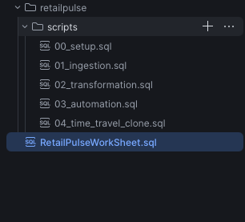

## Données

Événements de vente au format JSON Lines (un objet par ligne) :

```json
{"transaction_id": "TX-000001",
 "customer_info": {"id": "C-0037", "email": "manon.37@webmail.be", "country": "ES"},
 "items": [{"sku": "SKU-106", "name": "Veste imperméable", "quantity": 1, "unit_price": 99.0}, …],
 "total_amount": 278.8,
 "event_timestamp": "2026-07-25T12:50:39Z"}
```

| Lot | Période | Volume | Usage |
| --- | --- | --- | --- |
| Lot 1 | juillet à septembre 2026 | 3 fichiers, 900 ventes | chargement initial |
| Lot 2 | 1er au 10 octobre 2026 | 1 fichier, 150 ventes | démonstration du stream et de la task |

## Déploiement

Prérequis : un compte Snowflake (édition Enterprise pour le Time Travel au-delà d'un jour) et l'interface Snowsight.

1. Exécuter `00_setup.sql` en entier, après avoir remplacé `<NOM_UTILISATEUR>` par le résultat de `SELECT CURRENT_USER();`.
2. Exécuter `01_ingestion.sql` jusqu'au stage, déposer les 3 fichiers du lot 1 dans `RAW_STAGE` (chemin `lot_01`), puis exécuter le `COPY INTO`.
3. Exécuter `02_transformation.sql` **une seule fois**.
4. Exécuter `03_automation.sql` jusqu'à l'activation de la task, déposer le lot 2 (chemin `lot_02`), puis exécuter la section de démonstration.
5. Exécuter `04_time_travel_clone.sql`.
6. Exécuter `05_tests.sql` pour vérifier le résultat. C'est une version améliorée de la feuille de travail `RetailPulseWorkSheet.sql` : les tests y sont structurés par étape pour s'y retrouver rapidement, chacun indique la valeur attendue, et la feuille ne modifie aucune donnée (elle peut être rejouée à tout moment).

Chaque script commence par son `USE ROLE` : c'est lui qui détermine le propriétaire des objets créés. Les scripts s'exécutent en entier, depuis la première ligne.

## Choix techniques

| Sujet | Choix | Justification |
| --- | --- | --- |
| Stage | interne, `DIRECTORY` activé, chiffrement `SNOWFLAKE_SSE` | pas de compte cloud externe à configurer ; fichiers visibles dans Snowsight |
| Format de fichier | `TYPE = JSON`, `MULTI_LINE = FALSE` | JSON Lines : chaque ligne est indépendante, une ligne défectueuse ne contamine pas la suivante |
| Table brute | `VARIANT` + `source_file`, `file_row_num`, `loaded_at` | conserver le JSON intact ; tracer l'origine exacte de chaque ligne (débogage, rechargement ciblé, fraîcheur) |
| Nombre d'articles | `nb_articles` = somme des quantités ; `nb_types_produit` = produits distincts | l'énoncé est ambigu : 2 baskets + 1 veste = 3 articles, 2 types de produits. Les deux mesures sont conservées |
| Commandes sans article | `FLATTEN(…, OUTER => TRUE)`, `COUNT(DISTINCT …)`, `COALESCE(SUM(…), 0)` | sans `OUTER`, une commande au tableau `items` vide disparaît silencieusement de la table de faits |
| Types | `NUMBER(10,2)` pour les montants, `TIMESTAMP_NTZ` pour la vente, `TIMESTAMP_LTZ` pour l'insertion | `NUMBER` sans précision arrondit à l'entier, `FLOAT` est approché, `DATE` perd l'heure |
| Stream | `APPEND_ONLY = TRUE` | la zone brute ne reçoit que des insertions ; plus léger qu'un stream standard |
| Task | horaire, `WHEN SYSTEM$STREAM_HAS_DATA(…)` | exécution sautée sans démarrer le warehouse quand il n'y a rien à traiter |
| Sécurité | `ANALYST_ROLE` : `USAGE` + `SELECT`, droit sur les tables futures | principe du moindre privilège ; `FACT_SALES` lisible dès sa création |

## Contrôles et résultats

Rapprochement entre les totaux calculés sur les fichiers source et ceux de `FACT_SALES` :

| Mesure | Lot 1 | Lot 1 + lot 2 |
| --- | --- | --- |
| Commandes (toutes distinctes) | 900 | 1 050 |
| Lignes d'articles | 2 253 | 2 628 |
| Articles | 3 147 | 3 645 |
| Chiffre d'affaires | 178 191,30 € | 204 909,10 € |

- Le lot 2 a été intégré uniquement par la task, à partir du stream (150 commandes, stream vide après exécution).
- Time Travel : CA France 98 714,10 € avant la mise à jour simulée, 108 585,51 € après (+10 %), puis restauration exacte.
- Clone : `RETAIL_DB_DEV` modifié (527 commandes) sans effet sur la production (1 050 commandes).
- `ANALYST_ROLE` (rôles secondaires désactivés) : lecture autorisée, suppression et création refusées.

## Le projet en captures

### Étape 1 – Infrastructure et sécurité

Warehouse créé éteint (`SUSPENDED`), en taille X-Small, avec arrêt automatique après 60 secondes :

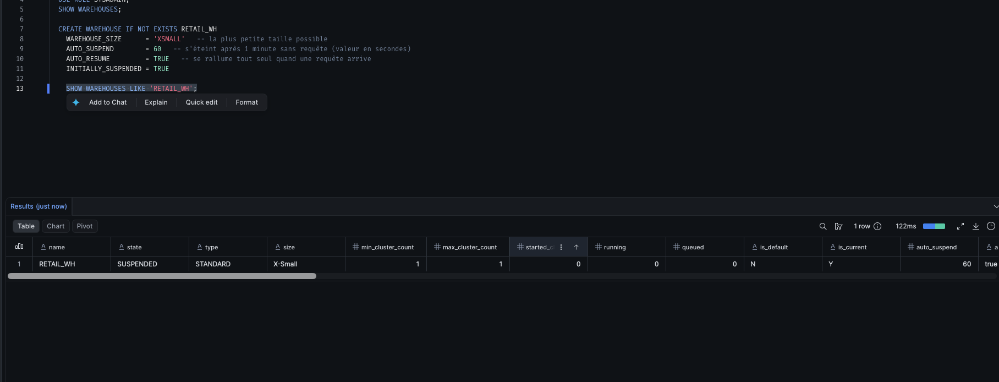

Schémas de `RETAIL_DB`, tous détenus par `SYSADMIN` (`PUBLIC` et `INFORMATION_SCHEMA` sont créés automatiquement) :

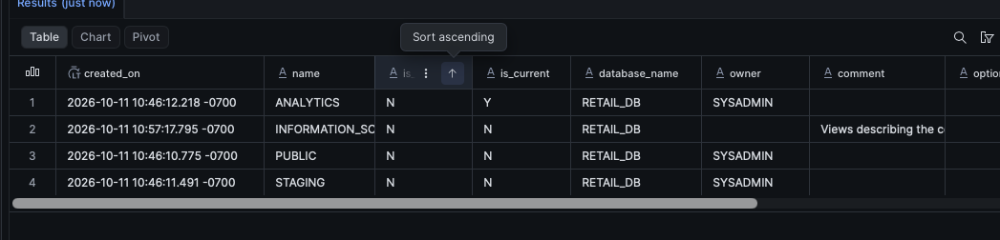

Test d'`ANALYST_ROLE` avec les rôles secondaires désactivés : la suppression est refusée.

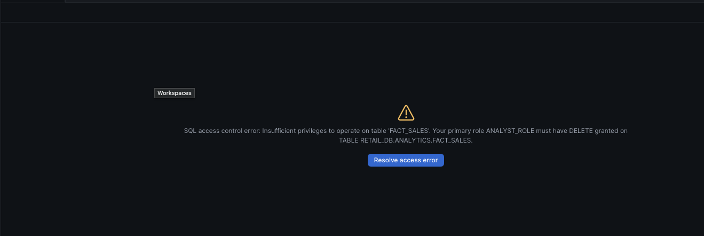

### Étape 2 – Ingestion JSON

Les 3 fichiers du lot 1 dans le stage interne, sous le chemin `lot_01` :

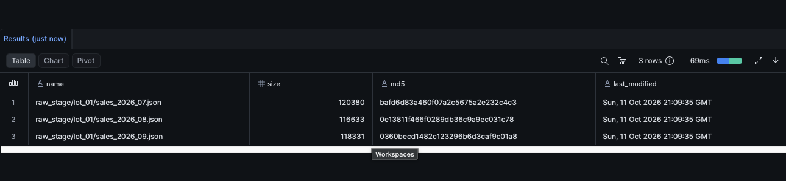

Lecture directe des fichiers avant chargement, avec les colonnes de métadonnées ; `$1` est déjà un `VARIANT` :

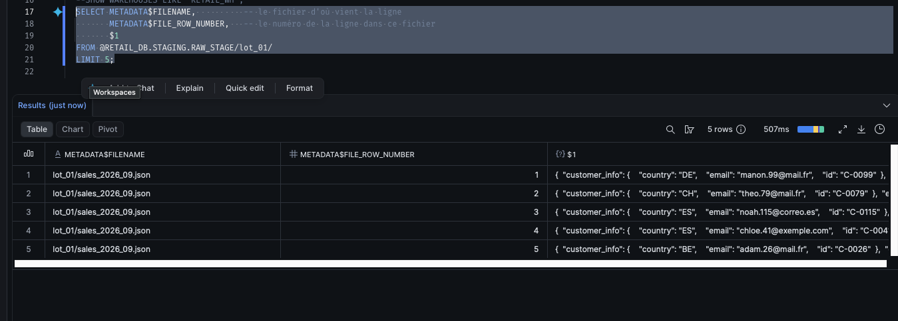

Historique des chargements : 3 fichiers `Loaded`, 300 lignes chacun :

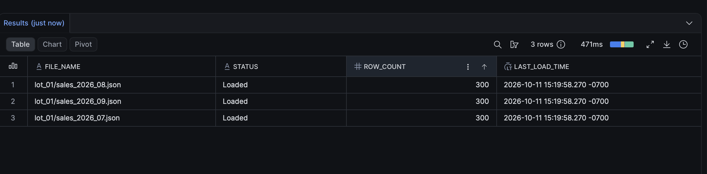

### Étape 3 – Transformation

`LATERAL FLATTEN` sur la commande `TX-000001` : une ligne par article, `f.value` contient l'article complet :

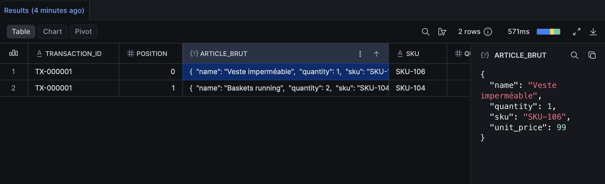

Contrôle : le montant recalculé à partir des articles est égal au `total_amount` du JSON :

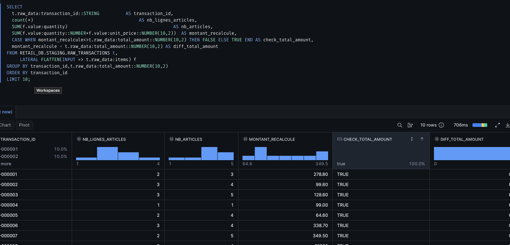

Rapprochement de `FACT_SALES` après le lot 1 :

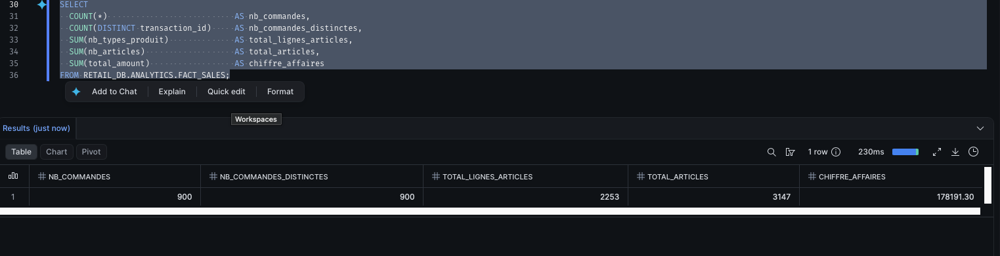

### Étape 4 – Stream et task

Exécution de la task réussie (`SUCCEEDED`) :

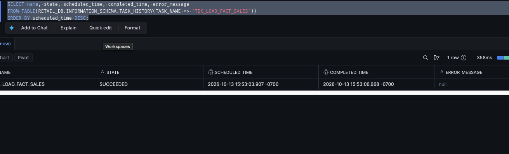

Rapprochement après l'intégration du lot 2 par la task :

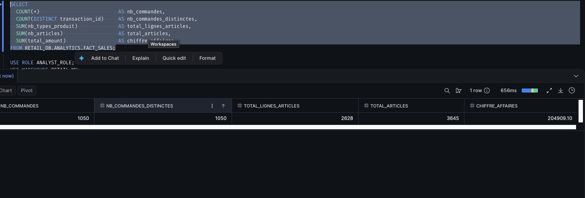

### Étape 5 – Time Travel et clone

Chiffre d'affaires France avant et après la mise à jour simulée de +10 % :

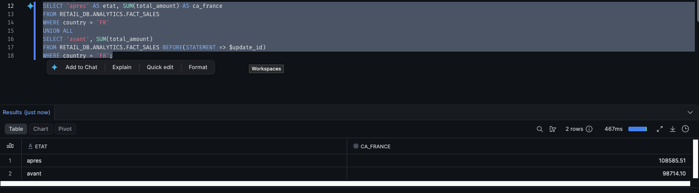

Indépendance du clone : la production garde ses 1 050 commandes, le clone modifié n'en a plus que 527 :

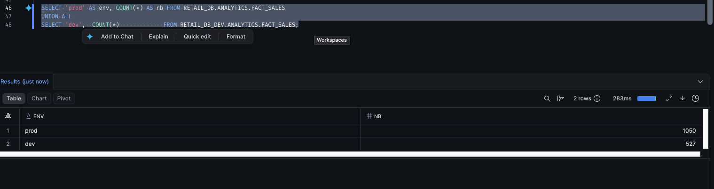

## Incidents rencontrés et enseignements

**Suppression accidentelle de `FACT_SALES` pendant le test du rôle analyste.** Dans Snowsight, la session active par défaut tous les rôles de l'utilisateur en rôles secondaires. Le `DELETE` lancé en `ANALYST_ROLE` a donc été autorisé par `ACCOUNTADMIN`, en arrière-plan. Diagnostic par `INFORMATION_SCHEMA.QUERY_HISTORY`, restauration par Time Travel (`BEFORE(STATEMENT => …)`), vérification par rapprochement. Enseignement : tester un rôle avec `USE SECONDARY ROLES NONE`.

**Fichier JSON corrompu dans la première version du lot 2.** Par défaut (`ON_ERROR = ABORT_STATEMENT`), le `COPY INTO` a rejeté tout le fichier. Avec `ON_ERROR = CONTINUE`, la lecture s'est arrêtée à la ligne défectueuse (91 lignes lues sur 154). La gestion des fichiers corrompus étant hors périmètre de l'énoncé, le lot a été remplacé par un fichier valide.

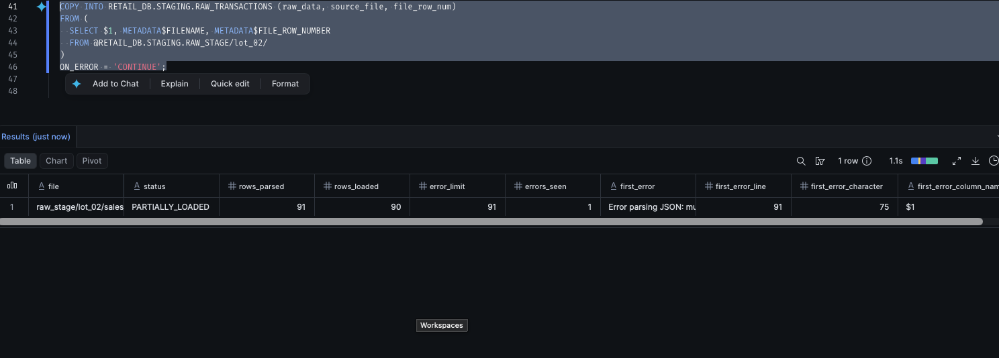

## Limites et améliorations possibles

- **Chargement initial non idempotent** : relancé, l'`INSERT` de `02_transformation.sql` dupliquerait les commandes. Un `MERGE` sur `transaction_id` le rendrait rejouable et protégerait aussi contre les transactions renvoyées en double.
- **Noms complets dans la task** : dans le clone `RETAIL_DB_DEV`, la task (suspendue) pointe toujours vers les objets de production. Des noms relatifs à la base éviteraient ce risque.
- **Fichiers corrompus** : charger chaque ligne comme texte puis appliquer `TRY_PARSE_JSON` permettrait de tout charger et d'isoler les lignes invalides.
- **Chargement des fichiers** : le `COPY INTO` est lancé manuellement ; Snowpipe ou une seconde task l'automatiseraient.
- **Déploiement** : relier le dépôt Git à Snowflake (`CREATE GIT REPOSITORY`) et exécuter les scripts avec `EXECUTE IMMEDIATE FROM`.
- **Partage** : exposer `FACT_SALES` à un autre compte avec Secure Data Sharing.
